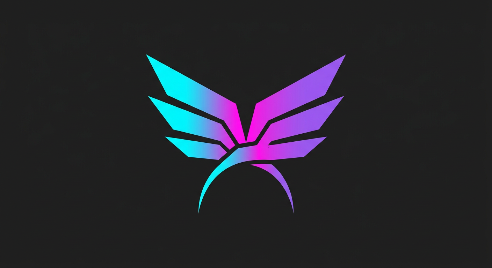

<p align="center">
  
</p>

<h1 align="center">FlyArchOs</h1>

<p align="center">
  <strong>Arch Linux, в котором сразу живут Hyprland и KDE Plasma.</strong><br>
  Один установочный ISO, графический установщик Calamares и установка без интернета.
</p>

<p align="center">
  <a href="https://github.com/Nan6767/OsNan/actions/workflows/ci.yml">
    
  </a>
  <a href="https://github.com/Nan6767/OsNan/actions/workflows/iso.yml">
    
  </a>
  
  
</p>

<p align="center">
  <a href="#скачать-один-iso"><strong>⬇️ Скачать ISO</strong></a>
  ·
  <a href="#быстрый-запуск-в-virtualbox"><strong>🖥️ Запуск в VirtualBox</strong></a>
  ·
  <a href="#документация"><strong>📚 Документация</strong></a>
</p>

> [!IMPORTANT]
> Сейчас доступна **бета-версия FlyArchOs 1.7.0-beta**. Для знакомства
> скачивайте **Mini №58** — это **один целый ISO-файл**, его не нужно
> распаковывать или склеивать из частей.
>
> Автоматические проверки подтвердили, что установщик Calamares находится
> внутри образа, но полный ручной сценарий «загрузка → установка → первый вход»
> ещё нужно подтвердить в VirtualBox. Поэтому сначала пробуйте FlyArchOs в
> виртуальной машине, а не на единственном рабочем диске.

---

## Скачать один ISO

### 👉 [Скачать FlyArchOs Mini №58 — один ISO-файл](https://github.com/Nan6767/OsNan/releases/download/iso-58-mini/flyarchos-1.7.0-beta-x86_64.iso)

Это основной вариант для большинства пользователей:

- **1 файл:** `flyarchos-1.7.0-beta-x86_64.iso`
- **размер:** 1 911 767 040 байт — примерно **1,78 ГиБ**
- внутри: Hyprland, KDE Plasma, Firefox и установщик Calamares
- установка работает **без интернета**
- архитектура: **x86_64**

Страница этого релиза:
<https://github.com/Nan6767/OsNan/releases/tag/iso-58-mini>

### Какой образ выбрать

| Образ | Что скачивать | Кому подходит |
|---|---|---|
| **Mini №58 — рекомендуется** | **один ISO** | Посмотреть систему, запустить в VirtualBox, выполнить обычную установку |
| [Full №57](https://github.com/Nan6767/OsNan/releases/tag/iso-57-full) | ZIP с ISO или части `.part00`–`.part05` | Нужны сразу дополнительные наборы программ, пресеты установщика и второе ядро |

Full №57 можно скачать
[одним ZIP-файлом](https://nightly.link/Nan6767/OsNan/actions/runs/40792766889/flyarchos-full-iso-57.zip):
архив нужно распаковать, а в VirtualBox подключать уже файл `.iso`.
Если браузер вместо загрузки покажет ошибку nightly.link, используйте
[запасную ссылку на тот же артефакт](https://nightly.link/Nan6767/OsNan/actions/artifacts/12864344250.zip).
Старая ссылка вида `/suites/.../artifacts/...` не работает (HTTP 500) и больше
не должна использоваться. Если ZIP недоступен, на странице Full-релиза лежат
постоянные части `.part00`–`.part05` и инструкция по склейке.

> [!WARNING]
> На странице Releases осталась долгая история разработки. Для новой загрузки
> используйте только **Mini №58** или **Full №57**. Не скачивайте сборки
> №49–№55 и старый релиз 1.0.0 — они помечены предупреждениями и не подходят
> для установки. Mini №56 — предыдущий кандидат с проверенным CI составом,
> но для нового скачивания он заменён сборкой №58.

<details>
<summary><strong>Контрольные суммы SHA-256</strong></summary>

Mini №58:

```text
e1ed46fad5443bb1c6e5ce71943af2c568fe59e3432f82579b750b012797ae07
```

Full №57:

```text
b64c3b13e9648465a510704a44c6d568c3ba1568be890418f1a8255be4347be7
```

Проверка в Windows PowerShell:

```powershell
Get-FileHash .\flyarchos-1.7.0-beta-x86_64.iso -Algorithm SHA256
```

Проверка в Linux:

```bash
sha256sum flyarchos-1.7.0-beta-x86_64.iso
```

</details>

---

## Быстрый запуск в VirtualBox


### Шаг 1. Скачайте Mini №58

Воспользуйтесь
[прямой ссылкой на один ISO](#скачать-один-iso).
Файл должен называться:

```text
flyarchos-1.7.0-beta-x86_64.iso
```

Не подключайте к VirtualBox ZIP-архив или файл `.part00`: нужен именно готовый
`.iso`.

### Шаг 2. Создайте виртуальную машину

В VirtualBox нажмите **Machine → New** / **Машина → Создать** и укажите:

| Поле | Что выбрать |
|---|---|
| Имя | `FlyArchOs` |
| ISO Image | скачанный `flyarchos-1.7.0-beta-x86_64.iso` |
| Type | `Linux` |
| Version | `Arch Linux (64-bit)` |
| Skip Unattended Installation | **включить** |
| Память | **12 ГБ** |
| Процессоры | **4** |
| EFI | **включить** |
| Диск | новый VDI, динамический, **40 ГБ или больше** |

> Галочка **Skip Unattended Installation** обязательна: FlyArchOs ставится
> через свой установщик Calamares, а не через автоматический сценарий
> VirtualBox.

### Шаг 3. Проверьте настройки перед запуском

Выделите виртуальную машину и откройте **Settings / Настройки**:

| Раздел | Настройки |
|---|---|
| **System → Motherboard** | EFI включён, Secure Boot выключен |
| **Порядок загрузки** | 1. Optical, 2. Hard Disk |
| **Display → Screen** | VMSVGA, 128 МБ видеопамяти, 3D-ускорение включено |
| **Storage** | в оптическом приводе выбран FlyArchOs ISO |
| **Network → Adapter 1** | NAT, Cable Connected включён |
| **USB** | USB 3.0 (xHCI), если планируете передавать устройства гостю |

#### Если ISO сам не подключился

1. Выключите виртуальную машину.
2. Откройте **Settings → Storage**.
3. Выберите оптический привод со статусом **Empty**.
4. Нажмите значок диска справа.
5. Выберите **Choose/Create a Virtual Optical Disk…**.
6. Нажмите **Add** и выберите скачанный `.iso`.
7. Нажмите **Choose**, затем **OK**.

### Шаг 4. Запустите FlyArchOs

Нажмите **Start / Запустить** и дождитесь рабочего стола.

Live-сессия предназначена только для знакомства и установки: её изменения не
сохранятся после перезагрузки.

Если появится экран входа:

```text
Пользователь: fly
Пароль:       flyarchos
```

Самые нужные клавиши в Hyprland:

| Клавиши | Действие |
|---|---|
| `Super+Enter` | терминал |
| `Super+D` | меню приложений |
| `Super+B` | Firefox |
| `Super+E` | файловый менеджер |
| `Host+F` | полный экран VirtualBox |

Клавиша **Host** в VirtualBox на Windows и Linux по умолчанию — правый `Ctrl`.

### Шаг 5. Установите систему на виртуальный диск

1. Нажмите `Super+D`.
2. Введите `Install`.
3. Запустите **Install FlyArchOs**.

Если ярлык не нашёлся, откройте терминал и выполните:

```bash
flyarchos-install
```

Для первой установки выбирайте простой вариант:

| Шаг установщика | Значение |
|---|---|
| Разметка | **Стереть диск** |
| Диск | виртуальный VDI на 40 ГБ |
| Файловая система | **btrfs** |
| Swap | **swap-файл** |
| Шифрование | первый раз выключить |
| Окружение | **Hyprland + KDE Plasma** |
| Загрузчик | **GRUB** |
| Пользователь | создайте своего пользователя |

> «Стереть диск» здесь относится к виртуальному файлу `.vdi`, а не к
> физическому диску вашего компьютера. На экране сводки всё равно проверьте,
> что выбран именно виртуальный диск.

### Шаг 6. После установки уберите ISO

Это самый часто забываемый шаг.

1. Дождитесь завершения установки.
2. В окне виртуальной машины откройте **Devices → Optical Drives**.
3. Выберите **Remove disk from virtual drive**.
4. Только после этого перезагрузите виртуальную машину.

Если ISO не убрать, VirtualBox может снова загрузить live-систему вместо уже
установленной FlyArchOs.

### Если что-то не получилось

| Проблема | Что проверить |
|---|---|
| `No bootable medium found` | ISO подключён к оптическому приводу, Optical стоит первым, Secure Boot выключен |
| Снова загружается live-система | ISO после установки не извлекли |
| Чёрный экран | Оставить VMSVGA и 128 МБ, выключить 3D-ускорение и повторить |
| Нет интернета | Адаптер NAT включён, Cable Connected отмечен |
| Не открывается установщик | Использовать Mini №58/Full №57 и команду `flyarchos-install` |

📖 Подробно — сеть и SSH, Guest Additions, общие папки, USB, разрешение экрана
и вся диагностика — в полном руководстве:
**[docs/VIRTUALBOX.md](docs/VIRTUALBOX.md)**.

---

## Что умеет FlyArchOs

### Два рабочих стола в одной системе

- **Hyprland** — быстрый тайлинговый Wayland-композитор с панелью Waybar,
  меню Wofi, терминалом Kitty, уведомлениями Mako и блокировкой Hyprlock.
- **KDE Plasma** — привычный классический рабочий стол с Dolphin, Konsole,
  Discover и системными настройками KDE.

В установщике можно оставить оба окружения или только одно.

### Установка без интернета

Calamares копирует уже собранную live-систему на диск и убирает группы
пакетов, которые пользователь не выбрал. Поэтому для установки не нужно
скачивать пакеты из сети.

В полном образе дополнительно доступны:

- наборы «Разработка», «Игры», «Мультимедиа», «Офис» и «Приватность»;
- пресеты «Игровой ПК», «Рабочая станция», «Приватность» и «Всё сразу»;
- выбор файловой системы, загрузчика, swap и шифрования LUKS;
- второе ядро Linux LTS.

### Внешний вид и обои

В образе 14 обоев: 6 авторских AI-изображений и 8 процедурных градиентов.
Генератор обоев установлен прямо в систему:

```bash
flyarchos-wallpaper list
flyarchos-wallpaper set 05-nord-fjord
flyarchos-wallpaper random
flyarchos-wallpaper-gen --theme aurora --seed 3 -o ~/pic.jpg
```


### Удобные команды после установки

| Команда | Что делает |
|---|---|
| `flyarchos-welcome` | помощник первого запуска |
| `flyarchos-update` | обновление системы и Flatpak |
| `flyarchos-doctor` | диагностика служб, диска, сети, звука и журналов |
| `flyarchos-snapshot` | снимки и откат btrfs через Snapper |
| `flyarchos-backup` | резервные копии домашнего каталога |
| `flyarchos-clean` | уборка кэшей и журналов |
| `flyarchos-aur` | установка и обновление AUR |
| `flyarchos-exe` | запуск Windows-программ через Wine |
| `flyarchos-profile` | изменить выбранные наборы программ |
| `flyarchos-info` | краткая справка и горячие клавиши |

---

## Документация

| Что нужно | Куда смотреть |
|---|---|
| 🚀 Запустить в VirtualBox | [Быстрый запуск выше](#быстрый-запуск-в-virtualbox) |
| 🖥️ Полная настройка VirtualBox | [docs/VIRTUALBOX.md](docs/VIRTUALBOX.md) |
| ✅ Проверить бета-кандидат по чек-листу | [docs/VIRTUALBOX-TEST.md](docs/VIRTUALBOX-TEST.md) |
| 💿 Установка и шаги Calamares | [docs/INSTALL.md](docs/INSTALL.md) |
| 🛠️ Собрать ISO самостоятельно | [docs/BUILD.md](docs/BUILD.md) |
| 🧩 Как устроен репозиторий | [docs/STRUCTURE.md](docs/STRUCTURE.md) |
| 📥 Все релизы | [GitHub Releases](https://github.com/Nan6767/OsNan/releases) |
| 🐛 Сообщить об ошибке | [GitHub Issues](https://github.com/Nan6767/OsNan/issues) |

При сообщении об ошибке укажите номер сборки, версию VirtualBox, настройки
виртуальной машины, этап, на котором всё остановилось, и скриншот ошибки.
Команды для сбора логов есть в
[чек-листе VirtualBox](docs/VIRTUALBOX-TEST.md).

---

## Статус проекта

- Текущая рекомендуемая загрузка: **FlyArchOs 1.7.0-beta Mini №58**.
- Полный вариант: **FlyArchOs 1.7.0-beta Full №57**.
- CI проверяет содержимое ISO, наличие Calamares, модуля `packagechooser`,
  live-пользователя и ключевые файлы live-образа.
- Полный графический тест в VirtualBox ещё должен быть пройден вручную:
  `live → Calamares → офлайн-установка → загрузка с виртуального диска`.
- Политика версий проекта: стабильной может быть только версия не выше
  **1.0.0**; версии 1.1.0+ относятся к бета-каналу. Конкретный старый релиз
  1.0.0 сейчас помечен **«⛔ НЕ загружается»** — не используйте его.

Лог автоматической сборки Mini №58:
[logs/iso-run-58.log](logs/iso-run-58.log).

---

<details>
<summary><strong>Для разработчиков: сборка и устройство проекта</strong></summary>

### Собрать ISO из исходников

```bash
# 1. На Arch Linux или в контейнере archlinux поставить инструменты
sudo pacman -S --needed archiso git python python-yaml

# 2. Проверить дерево и тесты
make check && make test

# 3. Собрать образ
sudo ./scripts/build-iso.sh
```

Готовый ISO появится в `out/flyarchos-*.iso`. Подробности сборки:
[docs/BUILD.md](docs/BUILD.md).

### Как работает установка

ISO собирается «жирным»: live-система уже содержит окружения и доступные
для профиля пакеты. Calamares распаковывает squashfs на целевой диск, затем
`flyarchos-profile` удаляет пакеты невыбранных групп:

```text
Calamares: окружение = hyprland, наборы = gaming,media
        ↓
flyarchos-profile --apply --desktop=hyprland --extras=gaming,media --remove-live
        ↓
pacman -Rns ← пакеты невыбранных групп, кроме нужных оставшимся группам
```

Источник правды по пакетам — папка `groups/`:

```text
groups/00-core.txt       ядро, сеть, диски, звук, консоль
groups/10-common.txt     шрифты, темы, Wayland-утилиты
groups/20-hyprland.txt   Hyprland и его окружение
groups/30-plasma.txt     KDE Plasma, SDDM, KDE-приложения
groups/40-apps.txt       браузеры и повседневные приложения
groups/50-dev.txt        разработка, Docker, виртуальные машины
groups/60-gaming.txt     Steam, Wine и игровые драйверы
groups/70-media.txt      графика, видео и 3D
groups/80-office.txt     LibreOffice и почта
groups/85-privacy.txt    приватность и безопасность
groups/99-live.txt       только live/installer-пакеты
groups/aur.txt           пакеты, собираемые из AUR
```

### Структура репозитория

```text
groups/       списки пакетов для ISO и установщика
profile/      archiso-профиль, live-система и Calamares
scripts/      сборка, генераторы, проверки и тесты
assets/       исходная графика и логотип
docs/         документация пользователя и разработчика
docker/       контейнерный сценарий сборки
logs/         сохранённые логи GitHub Actions
```

Подробная карта файлов: [docs/STRUCTURE.md](docs/STRUCTURE.md).

</details>

---

## Лицензия

Исходный код FlyArchOs распространяется под MIT. Обои и логотип — CC0-1.0.
Пакеты принадлежат своим авторам: Arch Linux, AUR, KDE, Hyprland и другим
проектам.
