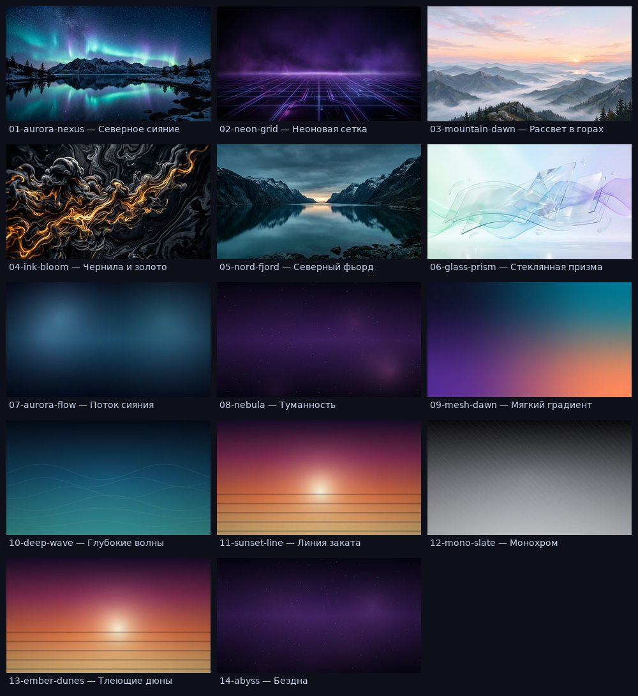

# FlyArchOs

**FlyArchOs Linux** — это готовый к сборке дистрибутив на базе Arch Linux с двумя
рабочими окружениями в одном установочном ISO: **Hyprland** (тайлинговый
Wayland-композит) и **KDE Plasma** (классический рабочий стол). Оба окружения
живут в образе одновременно, а установщик (**Calamares**) даёт выбрать, что
оставить на диске.

```
  _____ _       ___       _    ____   ___  ____
 |  ___| |     / _ \     / \  / ___| / _ \/ ___|
 | |_  | |    / /_\ \   / _ \| |    | | | \___ \
 |  _| | |___|  _  |  / ___ \ |___ | |_| |___) |
 |_|   |_____|_| |_| /_/   \_\____| \___/|____/
```

## Что внутри

| Возможность | Как сделано |
|---|---|
| Два окружения | `Hyprland` (Waybar + Wofi + Mako + Kitty + hyprlock) и `KDE Plasma 6` (Dolphin, Konsole, Discover, Wayland-сессия) |
| Разнообразная установка | Calamares: выбор окружения, наборов ПО, загрузчика, файловой системы, шифрования LUKS, swap-файла |
| Офлайн-установка | Все ~300 пакетов внутри squashfs: установщик копирует live-систему и удаляет невыбранные группы (`flyarchos-profile`) |
| 14 обоев | 6 авторских (AI) + 8 процедурных (генератор встроен в систему) |
| Свои обои одной командой | `flyarchos-wallpaper-gen --theme aurora --seed 3 -o ~/pic.jpg` |
| Помощник первого запуска | `flyarchos-welcome`: обои, наборы ПО, обновление системы |
| Обновление одной командой | `flyarchos-update`: pacman + Flatpak, зеркала (reflector), автоматом снимки btrfs до/после |
| Диагностика | `flyarchos-doctor`: упавшие службы, диск, журнал, сироты, .pacnew, сеть, звук, GPU |
| Снимки системы | `flyarchos-snapshot`: btrfs/snapper без боли — создать, список, откат |
| Резервные копии | `flyarchos-backup`: инкрементные снимки домашнего каталога (rsync --link-dest): создать, список, восстановить, проредить |
| Уборка системы | `flyarchos-clean` (по умолчанию только отчёт, `--apply` — почистить кэш пакетов, журнал, миниатюры, лишнее Flatpak) |
| Автобэкап | `flyarchos-backup auto on` — ежедневная копия дома по systemd-таймеру (хранятся 7 последних) |
| AUR одной командой | `flyarchos-aur install` ставит yay из AUR, `flyarchos-aur update` обновляет систему и AUR разом |
| Программы Windows (.exe) | `flyarchos-exe` + Wine: запуск .exe/.msi двойным кликом, `setup` готовит окружение с DXVK, установка программ, ярлыки с иконками из .exe, список установленных; «бутылки» — отдельные окружения под каждую программу |
| Пресеты установки | сценарии одним кликом в установщике полного образа: «Игровой ПК», «Рабочая станция», «Приватность», «Всё сразу» — плюс ручной выбор наборов сверху |
| Приватность | группа в установщике: Tor Browser, OnionShare, VeraCrypt, очистка метаданных, Firejail, UFW, графический интерфейс gufw; файрвол включается автоматически при установке набора |
| Комфорт Hyprland | история буфера обмена (Super+Shift+V), скриншот в файл (Super+Shift+P), ночной режим (Super+N), кнопки и погода в панели Waybar, фирменный фон экрана входа SDDM |
| Темы оформления | `flyarchos-theme`: 8 пресетов (обои + акцент Plasma + градиент рамок Hyprland), Super+Shift+W — следующая |
| Обои дня | раз в сутки случайные обои (systemd user timer) |
| Индикатор обновлений | модуль Waybar показывает число обновлений, клик открывает `flyarchos-update` |
| Справка по клавишам | `flyarchos-info --keys` или Super+/ |
| Единые обои для обоих окружений | `flyarchos-wallpaper set <id>` понимает Hyprland (swww) и Plasma (`plasma-apply-wallpaperimage`) |
| Брендинг | логотип, тема GRUB, слайд-шоу, оформление Calamares, ASCII-логотип в fastfetch |

### Обои



Шесть картинок сгенерированы нейросетью, шесть — процедурным генератором
(`scripts/pack-wallpapers.py` вызывает тот же `wallpapers.py`, что установлен в
системе). Для KDE Plasma каждая картинка оформлена отдельным KPackage-пакетом
(`/usr/share/wallpapers/FlyArchOs-*`), поэтому они видны в «Параметры системы →
Внешний вид» по отдельности.

## Готовый ISO

Образ собирается автоматически в GitHub Actions и публикуется в
**релизах**: <https://github.com/Nan6767/OsNan/releases>.

* `iso-*-mini` — компактный образ (< 2 ГБ): **цельный ISO одним файлом**,
  оба окружения, Firefox и установщик, без тяжёлых наборов и второго ядра;
* `iso-*-full` — «жирный» образ со всеми наборами ПО (~7,6 ГБ);
* `iso-*-slim` — только два окружения и базовые приложения (~3,7 ГБ);
* рядом с образом лежит `.sha256`. Образы больше 2 ГБ GitHub в релиз одним
  файлом не принимает (жёсткий лимит), поэтому они дополнительно нарезаны
  на части `.partNN` с `JOIN-README.txt`, а цельный файл тех же образов
  лежит **одним ZIP-файлом** в артефактах запуска Actions —
  ссылка «одним файлом» есть в описании каждого full-релиза (артефакт живёт 90 дней).

**Политика версий:** стабильная линия — **1.0.0** (полный образ). Всё, что
выше (1.1.0, 1.2.0, 1.3.0-бета, 1.4.0-бета, 1.5.0-бета, 1.6.0-бета, **1.7.0-бета**…), — бета-канал: свежие возможности до
включения в стабильную линию. Такие релизы помечены в GitHub как
*pre-release*, а имя файла содержит `-beta`.

## Быстрый старт (сборка из исходников)

```bash
# 1. На Arch Linux (или в контейнере archlinux) ставим инструменты
sudo pacman -S --needed archiso git python python-yaml

# 2. Проверяем, что дерево целое (можно и не на Arch)
make check && make test

# 3. Собираем ISO (~40-60 минут, нужно 40+ ГБ свободного места)
sudo ./scripts/build-iso.sh
```

Готовый образ — в `out/flyarchos-*.iso`. Пишем его на флешку
(`dd`, Ventoy, balenaEtcher) и грузимся в UEFI или BIOS-режиме.

Подробности: **[docs/BUILD.md](docs/BUILD.md)** (сборка) и
**[docs/INSTALL.md](docs/INSTALL.md)** (установка).

## Как устроена установка

ISO собирается «жирным»: в live-системе установлено **всё** (оба окружения и все
наборы ПО). Установка — это распаковка squashfs на диск, поэтому сеть не нужна.
Выбор пользователя превращается в **удаление лишнего**:

```
Calamares: окружение = hyprland, наборы = gaming,media
        ↓
shellprocess@profile:
  flyarchos-profile --apply --desktop=hyprland --extras=gaming,media --remove-live
        ↓
  pacman -Rns  ← пакеты групп plasma, dev, office, live
        (минус всё, что нужно оставшимся группам)
```

Списки пакетов лежат в **`groups/`** — это единственный источник правды:

```
groups/00-core.txt      118  ядро, сеть, диски, звук, консоль
groups/10-common.txt     42  шрифты, темы, Wayland-утилиты
groups/20-hyprland.txt   14  Hyprland + Waybar/Wofi/Mako/Kitty
groups/30-plasma.txt     38  KDE Plasma + SDDM + KDE-приложения
groups/40-apps.txt       10  Firefox, Chromium, Telegram, Discord…
groups/50-dev.txt        32  компиляторы, Docker, ВМ, VS Code
groups/60-gaming.txt     24  Steam, Wine, драйверы (вкл. 32-бит)
groups/70-media.txt      12  GIMP, Krita, Kdenlive, OBS, Blender…
groups/80-office.txt      7  LibreOffice, Thunderbird
groups/99-live.txt        4  Calamares и прочее только для ISO
```

Добавили пакет в `groups/*.txt` → `make packages` → образ и установщик узнают о
нём одновременно.

## Управление после установки

```bash
flyarchos-welcome            # помощник первого запуска (обои, наборы ПО)
flyarchos-wallpaper list     # показать обои
flyarchos-wallpaper set 02-neon-grid
flyarchos-wallpaper random
flyarchos-wallpaper-gen --list        # свои обои: 8 тем, любой seed
flyarchos-profile show --desktop=plasma   # что будет удалено/оставлено
flyarchos-profile --apply --desktop=both --extras=dev,media
flyarchos-info               # краткая справка о системе
```

Горячие клавиши Hyprland: `SUPER+Enter` — терминал, `SUPER+D` — меню,
`SUPER+W` — случайные обои, `SUPER+L` — блокировка, `Print` — скриншот в буфер,
`SUPER+1..0` — рабочие столы, `Alt+Shift` — переключение раскладки us/ru.
Полный список — в `profile/airootfs/etc/skel/.config/hypr/hyprland.lua` (Hyprland 0.57+ использует Lua-конфиг).

## Структура репозитория

```
groups/          списки пакетов (источник правды и для ISO, и для установщика)
profile/         archiso-профиль: profiledef.sh, packages.x86_64, airootfs/
  airootfs/etc/calamares/   настройки установщика (settings.conf, modules/, branding/)
  airootfs/etc/skel/        конфиги Hyprland и Plasma для новых пользователей
  airootfs/usr/lib/flyarchos/   инструменты: profile_tool, wallpaper_tool, welcome
scripts/         gen-packages.py, build-iso.sh, build-aur.sh, pack-wallpapers.py, check.py
docker/          Dockerfile для сборки ISO без Arch на хосте
docs/            BUILD.md, INSTALL.md, STRUCTURE.md, preview.png
```

Подробно — **[docs/STRUCTURE.md](docs/STRUCTURE.md)**.

## Статус проекта

Репозиторий содержит **полный исходник дистрибутива**: профиль archiso,
установщик, конфиги окружений, обои, инструменты и проверки (`make check`,
`make test` — 22 теста на логику выбора групп). Сам ISO собирается на машине с
Arch Linux (в песочнице нет ни `pacman`, ни ядер Arch, поэтому готовый образ
здесь не собран) — одна команда `sudo ./scripts/build-iso.sh`.

## Лицензия

Исходники — MIT. Обои и логотип — CC0-1.0. Пакеты принадлежат своим
авторам (Arch Linux, AUR, KDE, Hyprland).
